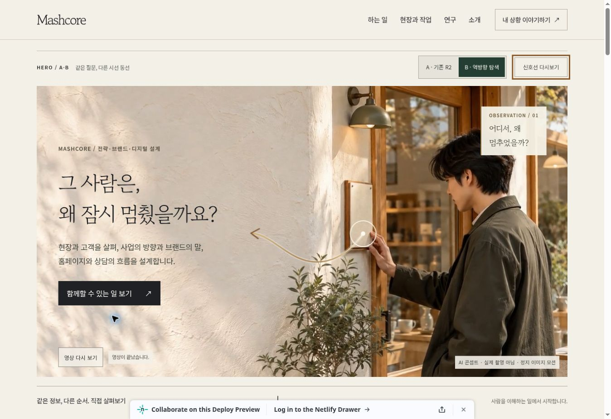

# P01 — Homepage experience follow-up

2026-10-26 / **IMPLEMENTED_IN_DRAFT / NOT_PRODUCTION_APPROVED**

작업 기준: 사용자 제공 `MASHCORE_WEB_EXPERIENCE_TOOL_PROTOCOL_v1.0_20261026(1).md` 및 `P01_HOMEPAGE_BUILD_EXECUTION_PROMPT_v1.0_20261026` 본문. 구현 범위는 기존 Experience R2 / Hero Reverse의 **홈 origin 히어로와 검토용 비교 화면**입니다. 별도 에디토리얼 사이트의 코드를 가져오거나 전체 사이트를 다시 만들지 않았습니다.

## 1. 방문자의 질문과 다음 행동

- 질문은 기존 R2의 “그 사람은, 왜 잠시 멈췄을까요?”를 보존합니다.
- 다음 행동은 기존 `/services/` 링크입니다. 문의는 독립된 `/#invitation`에서 사용자가 직접 메일 앱을 열거나 내용을 복사하는 흐름입니다.
- B의 단서 시작점을 인물의 목 부근에서 **안내 카드를 확인하는 자리**로 옮겼습니다. 질문이나 CTA를 애니메이션 뒤에 숨기지 않습니다.
- 모바일 B는 질문 → 설명 → CTA → 장면 순서입니다. 390×844에서 CTA 상단이 A 708px, B 406px로 측정되었습니다. A의 기존 장면 우선 배치는 비교 기준으로 남겼습니다.
- A/B의 핵심 질문·설명·CTA는 같습니다. 이는 내용의 우열이나 실제 시선 추적 결과를 주장하는 실험이 아닙니다.

## 2. 기준 ref와 보존

| 대상 | 확인한 상태 |
|---|---|
| 운영 main | `b31a55cea32cd83113624f9cdc27bd8d8bc36926` |
| Draft #2 | `feature/mashcore-weplace-portfolio-20261019` / `9e857fdca62b66bd7d81ecc3492940124a02c08a` |
| Experience R2 Draft #6 | `review/mashcore-renewal-20261023` / `b0aeca2946701b25a32c34a66f58eac412b1b416` |
| 직접 기준 Hero Reverse Draft #7 | `review/mashcore-hero-reverse-20261026` / `165ccba83b34b599731ef88029971c5c74875c00` |
| 후속 작업 브랜치 | `review/mashcore-p01-motion-20261026` |
| 시작 작업 트리 | 새 격리 clone, 미커밋 변경 없음 |
| 빌드 | `python3 scripts/build_public.py --context deploy-preview` → `dist` |

main의 빌드 없는 계보와 R2의 생성 계보를 혼용하지 않았습니다. #2/#6/#7 및 기존 Figma 프레임은 변경하지 않았습니다. 후속 PR의 main 대상 전체 diff에는 기존 R2/#7 내용도 포함되므로 **이번 변경은 #7 HEAD와의 비교**로 보아야 합니다.

현재 main에는 `netlify.toml`과 `build_public.py`가 없고 정적 원본을 유지합니다. 미병합 R2/#7에는 생성 빌드·검토용 서비스 가격안·콘텐츠/자산 설정·Weplace 상세·Hero Reverse가 추가되어 있습니다. 사업자 상호·대표자·등록번호·주소·이메일 값은 current main과 같은 값이며, 전화번호는 미확인 상태로 남겼습니다. 이번 후속 작업은 이 미병합 내용을 새로 승인하거나 운영 기준으로 승격하지 않습니다.

기준 HEAD를 별도 worktree에서 같은 명령으로 빌드해 비교했습니다. 서비스·소개·연구·Chore to Play·연구 기록·Market Interpretation·Weplace 협업·환불 정책·생각 읽기 **9개 HTML은 바이트 단위 동일**합니다. 홈 `origin/research/field/invitation`, 3관점 A/B, 6관점·CSS 3D, 독립 문의, 사업자 정보, 승인 상태를 보존했습니다. 원본 이미지·영상·콘텐츠 JSON·사업자 설정·가격안은 변경하지 않았습니다. 구체적 해시는 `qa/p01/preservation.json`에 있습니다.

## 3. 도구 선택

| 선택 | 목적과 범위 |
|---|---|
| 기존 HTML 생성기 + CSS + SVG + JavaScript | 단일 경로를 유한하게 그리기, 사용자 정지·재생, 가시성·실패 상태 관리 |
| Figma 기존 Design 파일 | 기존 편집 프레임·모션 계보 보존, 코드와 맞춘 P01 Motion Card 추가 |
| 기존 Netlify Deploy Preview | 운영 사이트와 분리된 Draft 확인 |
| 로컬 Sites 검토 서버 | 생성된 `dist`의 브라우저 검수만 수행. 별도 Sites 운영 게시 없음 |
| Node VM / 임시 linkedom 0.18.12 | 런타임 상태·기존 3D 회귀 검사. 사이트 런타임 의존성에 추가하지 않음 |

GSAP은 이 단일 경로에 별도 타임라인 의존성을 추가할 필요가 없어 사용하지 않았습니다. Spline/Three.js는 이번 히어로의 사용자 질문에 실제 깊이나 카메라 조작이 필요하지 않아 추가하지 않았습니다. 기존 Chore to Play CSS 3D는 그대로입니다. Webflow/Astro/Next.js 전환·구독·새 결제를 수행하지 않았습니다.

## 4. 적용 파일·버전·자산

- `scripts/build_public.py`: 홈·모바일 홈에 기존 CSS를 같은 순서로 인라인하고, 요청한 A/B 구도와 비교 바 공간을 첫 표시 전에 준비합니다. 다른 9개 페이지의 출력은 바꾸지 않습니다. 홈 HTML당 약 57KB의 원본 CSS가 포함되는 대신 초기 외부 CSS 대기와 후속 재배치를 줄입니다.
- `scripts/review_r2.py`: 비교 바, 접근 가능한 재생 컨트롤, 안내 카드 위치를 가리키는 SVG.
- `assets/css/hero-reverse.css`: 유한 모션, 포커스, 정지 상태, B 모바일 순서.
- `assets/js/hero-reverse.js`: 정지·이어보기·다시보기, 빠른 A/B 전환 취소, 화면 이탈·복귀, 모션 감소·데이터 절약·포스터 오류 처리.
- `assets/js/hero-media.js`: `motion=still`일 때 자동 영상 요청을 하지 않는 명시적 히어로 정지 모드. 사용자 직접 재생 가능.
- `preview/index.html`, `assets/js/preview.js`, `assets/css/preview.css`: 실제 폭 A/B, 정지·JS 차단·텍스트 확대·미디어 404 시험, DOM·LCP·CLS 측정 표시.
- `scripts/check_p01_motion.cjs`: 위 상태 전환 10개 시나리오 그룹.

P01 기록 버전은 `1.1`입니다. 기존 R2 media config `2.0`은 변경하지 않았습니다. 기존 `hero-desktop/mobile.webp`와 6.5초 MP4는 **GENERATED**: 가상의 인물·장소를 만든 AI 정지 이미지 및 느린 디지털 확대입니다. 실제 현장 촬영·고객 증거가 아닙니다. `rights_verified=false`, `public_use_approved=false`를 그대로 유지했습니다. SVG 단서와 Figma 보드는 **PROTOTYPE / RECONSTRUCTED**, 사용자 이해를 돕는 설계 자료입니다. 새 사진·영상이나 실제 고객 자료를 업로드하지 않았습니다.

Figma 원본 페이지: <https://www.figma.com/design/e2C0JjYTRiwiW9Fxh3f8X7?node-id=46-179>

P01 Motion Card: <https://www.figma.com/design/e2C0JjYTRiwiW9Fxh3f8X7?node-id=57-179>

새 카드: 2535×702, Frame 4 / Text 13 / Rectangle 3 / Ellipse 3. 래스터를 붙인 화면이 아니라 편집 가능한 벡터·텍스트입니다. Gowun Batang / Noto Sans KR을 보존했습니다. 기존 A/B 화면·모션 노드는 삭제하거나 덮어쓰지 않았습니다. 새 카드는 코드 타이밍·정지/실패 조건을 기록한 스토리보드이며, 새 Figma 애니메이션 트랙을 추가했다는 뜻은 아닙니다. 실제 사진 배치·동작의 기준은 실행되는 Preview입니다.

## 5. 실행 Preview와 비교법

실행 확인한 [Draft #8](https://github.com/HotCharliepepper/Mashcore/pull/8)의 [B Preview](https://deploy-preview-8--mashcore.netlify.app/?hero=reverse)와 [화면 비교](https://deploy-preview-8--mashcore.netlify.app/preview/?view=mobile&page=%2F&hero=reverse)를 사용합니다. 실행 코드 commit은 `ebdfbf093d240e53ba79b99498e1fe389457bec8`입니다. 검증한 구현 deploy는 `qa/p01/deploy.json`에 기록하며, 뒤따르는 문서·QA 증거 커밋은 실행 코드를 바꾸지 않습니다.

| 경로 | 확인할 것 |
|---|---|
| `/` | 기본 A, 기존 R2 정보·CTA |
| `/?hero=reverse` | B, 안내 카드 → 질문의 단서 |
| `/?hero=reverse&motion=still` | B 정지 상태, 영상 자동 요청 없음 |
| `/preview/?view=mobile&page=%2F&hero=reverse` | 390px 실제 iframe 비교 |
| `/preview/` | 320·390·768·1440, A/B, 히어로 정지, JS 없이, 글자 200%, 포스터·영상 404 |

데스크톱은 신호선 정지·이어보기·다시보기를 지원합니다. ≤1100px에서는 선을 생략하고, ≤900px B에서는 문안과 CTA를 장면보다 먼저 놓습니다. 모션 감소·데이터 절약은 정적 B, JS 차단은 서버가 생성한 기본 A, 영상 실패는 포스터로 돌아갑니다. 포스터가 실패하면 해당 장면을 지칭하는 단서도 숨깁니다. 실패 시험은 검토 iframe에만 적용됩니다.

## 6. 실제 검사와 한계

환경: Linux, Python 3.12.14, Node 24.22.1, Cloud Chrome 브라우저, 로컬 `dist` / 실제 CSS viewport의 iframe. 실기기·브라우저 에뮬레이션이 아닌 **폭 재현**입니다.

| 검사 | 실행 결과 |
|---|---|
| 생성·정적 계약 | 12 HTML, 11 사업자 footer, 384 로컬 참조 통과; prototype 4개와 별도 main 가격 계보 보존 |
| 후속 모션 Node VM | 10 시나리오 그룹 통과 |
| 기존 문의·Research Node VM | 9 시나리오 그룹 통과 |
| 기존 3D Node + linkedom | 9 시나리오 그룹 통과. 처음에는 테스트 의존성 미설치로 실패했고 임시 검사 환경에 설치 후 재실행 통과 |
| 320/390/768/1440 A/B | 8개 조합 모두 가로 넘침 0px, H1·주 CTA 첫 화면 내 표시 |
| 390 정지 보기 | 영상 `src=null`, `reduced_motion`, 질문·CTA 유지 |
| 390 영상 404 | `error`, 포스터·질문·CTA 유지 |
| 390 포스터 404 | 포스터 미로드, 질문·CTA 유지, 신호선 완료·숨김 |
| 1440 정지 + 포스터 404 | 이미지·영상 없이도 H1·CTA 유지, 가로 넘침 0px |
| 390 JS 차단 | 기본 A / `poster_only`, 질문·CTA 유지 |
| 320 글자 200% | 가로 넘침 0px, CTA는 세로 스크롤로 접근(상단 981px) |
| 키보드 모션 | Enter 재생 → 정지(`paused`) → 이어보기 → 완료, `:focus-visible=true` |
| Research 브라우저 | 3관점 모두 Enter로 B 전환, 배치 변경·동일 내용 확인, A 복귀 |
| Chore to Play 브라우저 | 6관점 선택, 방향키 회전(8°)·Home 복귀(0°), JS 차단 상태에서도 평면 6관점 펼침 확인 |
| 문의 브라우저 | 시험 문자열의 mailto recipient/subject/body 확인, 입력 삭제. 발송·외부 앱 실행 안 함 |
| 서비스/Weplace/환불 | H1·사업자 정보 실제 DOM 확인 |

최종 Deploy Preview B의 단일 표본: **1440px LCP 284ms / CLS 0.00432, 390px LCP 428ms / CLS 0**. 배포 후 최초 검사에서 CLS 1.36862를 발견해 실제 이동한 DOM을 기록했고, 스타일 적용·A/B 초기화·비교 바 높이 변화의 순서를 보완했습니다. 같은 원본 CSS를 홈에 인라인하고 초기 구도·공간을 예약한 뒤 재측정한 결과입니다. 초기 로컬 LCP 200/272ms·CLS 0과 수정 과정은 원시 기록에 남겼습니다. 이 값들은 캐시 조건을 통제하지 않은 검토 iframe의 단일 관찰이며 운영 Core Web Vitals·INP나 실제 사용자 성능으로 일반화하지 않습니다.

**미실시:** 물리 iOS/Android 터치·센서, 실제 OS 모션 감소 설정 전환, 브라우저 전체 200% zoom, 네트워크/CPU 저속 제한, 실제 BFCache 재진입, GPU/합성기 강제 실패, 운영 RUM·INP·실제 사용자 이해도·문의 전환. Node 모형의 관련 검사는 실기기 결과를 대체하지 않습니다. 기존 3D는 WebGL 의존성이 없으며 GPU 실패를 검증했다는 주장을 하지 않습니다.

## 7. 측정된 사실과 가설

측정된 사실은 배치 좌표·표시 여부·정지/실패 상태·동일 콘텐츠·보존 해시와 위 검사 결과입니다. “안내 카드의 신호를 따라 자신의 고객 경험을 떠올린다”, “모바일 CTA가 먼저 보여 범위를 쉽게 이해한다”는 **아직 가설**입니다. 시선 추적·A/B 사용자 실험·문의 변화는 수집하지 않았습니다. 새 분석/추적 스크립트도 추가하지 않았습니다.

## 8. 승인 경계

main 병합, production 배포, 승인 플래그 승격, 결제·CRM·DB·고객 개인정보 변경, GBP 수정, Weplace 운영 변경을 수행하지 않았습니다. Netlify의 기존 운영 deploy는 `6adb113e296767181eb98f02`입니다. 실제 작성은 독립 Draft 코드·검토 Preview와 같은 Design 파일 내 후속 카드에 한정합니다. 가격/VAT 승인이 없는 production 빌드는 기존 guard로 차단됩니다.

Weplace 인계 변경: **없음**. 협업 상세·기여 범위 문안은 기준 출력과 동일하며 별도 사업자·문의·결제 계보를 합치지 않았습니다. 기존 GEO·GBP 검토안 역시 실제 설정 완료로 간주하지 않습니다.

## 9. 다음 작은 수정과 재사용 기록

1. 공개 가능한 실제 현장 사진·관찰 메모의 사용 허락을 확인하고, GENERATED 포스터와 비교할 후보 1개를 준비합니다.
2. 실제 iOS/Android에서 터치·OS 모션 감소·200% 확대·화면 복귀를 확인합니다.
3. 방문자에게 “무엇을 돕는 팀인가 / 다음에 어디로 가면 되는가”를 물어 A/B 이해 차이를 기록합니다. 전환 성과를 먼저 가정하지 않습니다.

재사용 파일: `P01_MOTION_ASSET_DECISIONS_20261026.json`, `qa/p01/`의 원시 검사 기록, `scripts/check_p01_motion.cjs`, Figma P01 Motion Card. 다른 고객사에 가져갈 때 인물·사업자·문의·성과 자료는 복사하지 않습니다.
