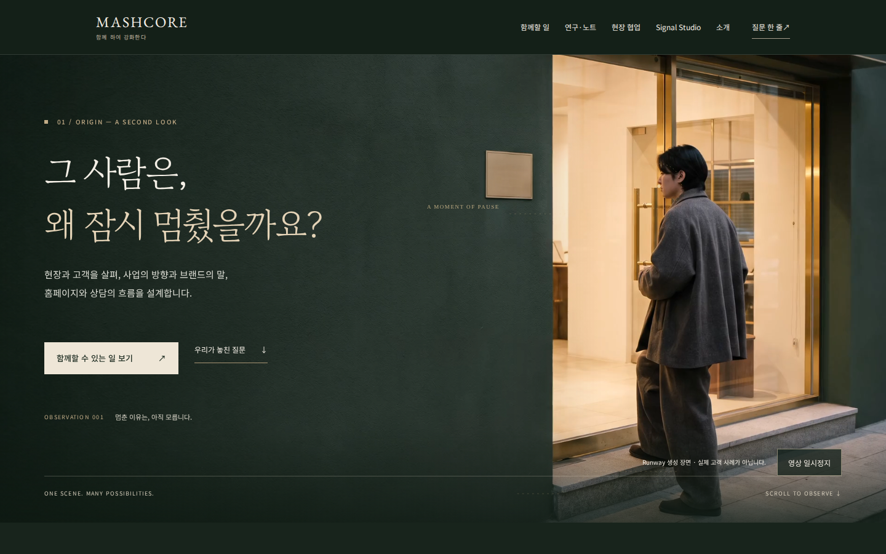
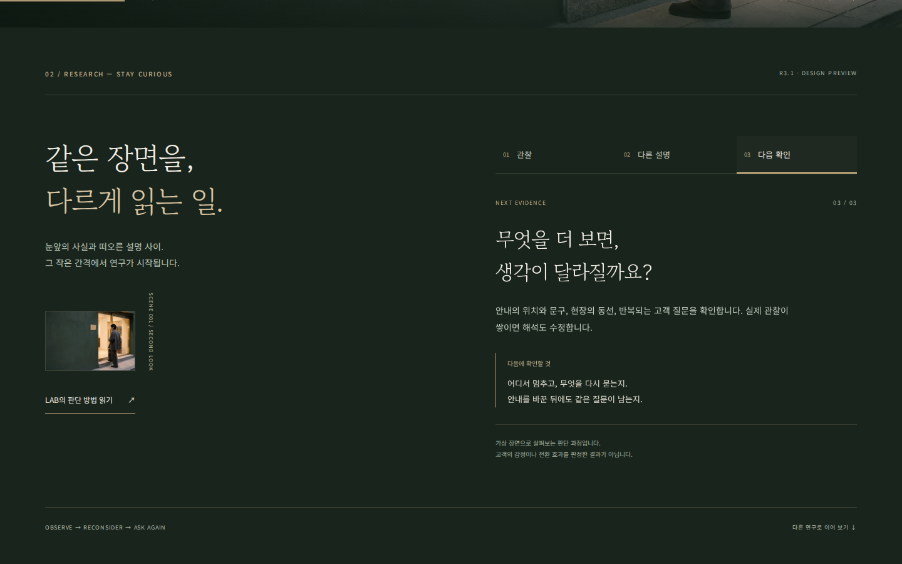

# R3.1 Origin × Research — 구현 및 검수

2026-10-28 KST. 상태: 인터랙티브 Preview 완료, Draft PR, 운영 적용 아님.

- [직접 체험](https://deploy-preview-12--mashcore.netlify.app/r31-review/)
- [Draft PR #12](https://github.com/HotCharliepepper/Mashcore/pull/12)
- [최종 브라우저 QA](https://github.com/HotCharliepepper/Mashcore/actions/runs/40687201693)
- [전체 22개 캡처 + JSON](https://github.com/HotCharliepepper/Mashcore/actions/runs/40687201693/artifacts/12815622089)
- 최종 실행 SHA: `44280f91869fd315e351c4908229d6307fe170cc`.
- 검수 Netlify deploy: `6ae1e8e6e4ce91bd4b8a23c4` / ready / deploy-preview / published_at=null.
- [검수 시점 고정 Preview](https://6ae1e8e6e4ce91bd4b8a23c4--mashcore.netlify.app/r31-review/)

## 기준과 출처

[Issue #11](https://github.com/HotCharliepepper/Mashcore/issues/11), 연결 Drive의 R3.1 Work 명세·동작 ZIP·웹 MP4·WebP를 직접 읽고 가져왔다. 공유 권한 변경, 사용자 재업로드, 유료 생성은 없다. 제공된 프로젝트 지침과 실행·QA 문서를 함께 적용했다.

기준 main: `2d38bb0cf68ea636cccb84e7ef9c0ce17043c017`. 기존 Draft #2/#6/#7/#8/#9 보존. 새 브랜치 `review/r31-origin-research-20261029`는 main에서 독립 분기했다. 브랜치 suffix는 식별자이며 기준 검수일은 위 날짜다. 기존 운영 배포 `6ae1a4963bb4e121a64b6c25`는 변경하지 않았다.

## 구현

- 소스: `experiments/r31-origin-research/{index.html,styles.css,app.js,assets/}`.
- 기존 홈페이지를 바탕으로 Origin·Research만 교체·확장. 원본 index/mobile/공용 CSS/공용 JS는 변경하지 않았다.
- 첫 렌더에 질문·역할·서비스 CTA. 인물·출입문 영상은 6.041667초, H.264, 1920×1080, 24fps, 무음, 2,181,118 bytes. WebP는 1600×900, 68,196 bytes. ZIP과 개별 자산 해시가 일치한다. 20MB 원본 마스터는 가져오거나 배포하지 않았다.
- GSAP 3.15.0을 출처·라이선스 헤더와 함께 자체 호스팅. 데스크톱의 미세한 신호선과 짧은 단계 전환에만 적용한다. 텍스트의 표시를 모션에 의존시키지 않는다.
- 모바일 DOM 순서는 문안·CTA→포스터→재생 버튼. 자동 영상 재생 없음. 데스크톱은 첫 진입 한 번 재생, 무한반복 없음. 정지·이어보기·다시보기, 화면 이탈/탭 숨김 일시정지.
- Research 3개 버튼은 관찰/다른 설명/다음 확인을 실제 변경. JS 차단 시 세 설명을 모두 읽을 수 있다.
- reduced-motion에서는 정지 포스터, saveData에서는 자동 영상/GSAP 중단. JS·GSAP·영상 실패에도 텍스트·CTA·문의 보존.
- origin/research/field/invitation 유지. Chore to Play 6개 관점은 별도 연구로 보존. LAB·NOTES·Studio·Weplace·서비스·정책·기존 문의 기능과 실제 사업자 footer 유지.
- 생성 자산임을 영상 가까이에 표시. 실제 고객 사례·심리 판정·성과로 표현하지 않는다.
- 현장·문의 구간은 원래 밝은 배경을 유지하도록 대비 수정. 이 실험 경로에서만 기존 scroll-snap을 해제해 문의 앵커가 중간 장면에서 멈추지 않도록 수정.

## 배포 경계

`prepare_public.py`가 deploy-preview에서만 명시된 6개 파일을 `dist/r31-review/`에 복사한다. production 및 branch-deploy는 기존 14페이지, deploy-preview는 15페이지. 폴더 통째 복사 금지, 심링크 차단, 미디어 3MB 상한, 불명 파일·원본 마스터·누락 검사. `check_release.py`가 정확한 파일 집합과 문서 구조를 검사한다.

Review HTML noindex/nofollow, HTTP X-Robots-Tag, 빈 Preview sitemap, 크롤러가 noindex를 읽을 수 있는 robots. canonical은 원본 홈페이지. noindex는 접근 제어가 아니며 Preview는 링크 소유자가 열 수 있다. 고객 자료·내부 원장·계약·미승인 가격 없음. 문서·스크린샷은 dist에 복사하지 않는다.

## 이번 실제 검사

| 검사 | 결과 |
|---|---|
| 최종 Chromium / Playwright 1.57.0 / Ubuntu 24.04 / 실제 Netlify Preview | **174 PASS / 0 FAIL** |
| 320×700, 390×844, 768×1024, 1440×900 | CTA 첫 화면, 가로 넘침 없음, 연구 3단계, 문의 앵커 도달 |
| 키보드 | skip, 순차 Tab, Enter/Space, focus 표시, 메뉴 Escape |
| 모바일 touch 에뮬레이션 | 탭 영상 재생·정지, 연구 선택, 메뉴 |
| 실제 영상 | 1920×1080 decode·시간 증가·pause/resume·이탈 pause·ended·replay |
| GSAP | 고정 3.15.0 로드·인물 주변 선/원 computed style 변화 |
| 실패 조건 | JS 차단, MP4 요청 중단, GSAP 요청 중단, 이미지 중단, reduced-motion, saveData |
| 하단 제목/강조 대비 | Field 12.61:1, Invitation 14.14:1 (전체 접근성 감사는 아님) |
| 링크 회귀 | 서비스/LAB/NOTES/Chore/Studio/Weplace 각 HTTP200 + H1 |
| 배포 경계 | 7/7 PASS 및 3개 context release 검사 PASS |
| 정적 사이트 구조·링크 | 16 source HTML, 오류 0 |
| 기존 Chore 공간 모형 Node DOM 검사 | 9 검사 그룹 PASS |

기존 `scripts/check_interactions.cjs`는 사업자 footer를 1행으로 기대해 실제 5행과 충돌하며 실패했다. **기준 main을 임시 사본으로 실행해 동일 `5 !== 1` 실패를 재현**했다. R3.1 회귀가 아니며 기존 테스트·공개 footer는 수정하지 않았다. 근거: `r31-evidence/legacy-main-interactions.txt`.

초기 QA: `5ee6960` 154 PASS. 중간 `e4b353d`는 no-JS 로딩 대기 때문에 151 PASS / 2 FAIL. CSS load 이후 측정 및 JS 없는 상태의 외부 polling으로 수정. 이후 `b984d28` 성공, 최종 `44280f9`에서 문의 앵커와 하단 대비까지 174 PASS. 과거 성공을 최종 실행으로 혼동하지 않는다.

Cloud Browser에서도 실제 Preview의 연구 버튼 전환·영상·문의 앵커를 직접 조작하고 시각 검수했다. 문의 이동 결과 section top 23.8px, scroll-snap none 확인. 메일 작성 링크를 준비하는 범위만 검사하며 실제 발송·접수는 하지 않았다.

## 미실시 및 남은 결정

실물 iPhone/Android, Safari/Firefox, 스크린리더 청취, 브라우저 기본 200% 확대, 현장 사용자 이해도, 실제 메일 송수신, 운영 CWV·전환 효과는 미실시. 별도 상호작용 녹화 파일은 만들지 않았다. GitHub CI 캡처와 실제 재생시간 검사를 증거로 남긴다.

운영 공개 자산 권리·최종 문안·히어로 채택은 별도 결정. main 병합/운영 배포/DNS/결제/실DB/유료 API/SNS/고객 데이터 사용은 수행하지 않았다. Weplace에는 기존 독립 협업 링크만 유지하며 계정·DB·계약·운영 변경 영향이 없다.

다음 시각 개선 후보: ① 제공 영상의 세로 crop을 비교해 모바일 인물 비중 조정 ② Research 단계별 신호선 강조 위치 차이 비교 ③ Chore 구간으로 넘어가는 여백과 페이지 길이를 실제 읽기 반응으로 조정. 이번 구현에는 추가 유료 생성이 필요하지 않다.

## 캡처

`r31-evidence/results.json`에 개별 검사와 SHA를 보존한다. 이 기록과 캡처를 추가하는 후속 커밋은 문서 전용이며 런타임 파일은 최종 검수 SHA와 동일하다.
