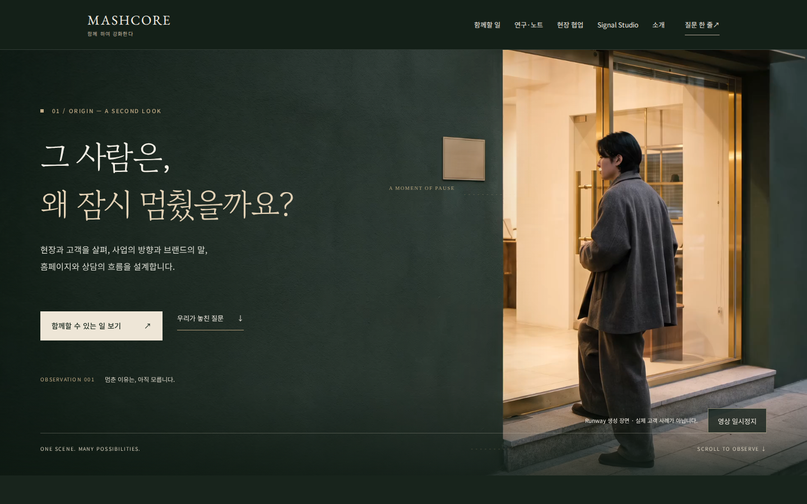
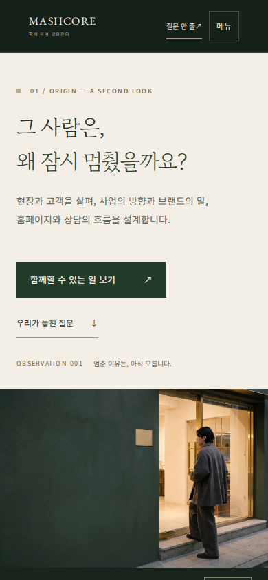
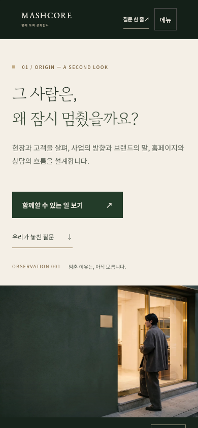
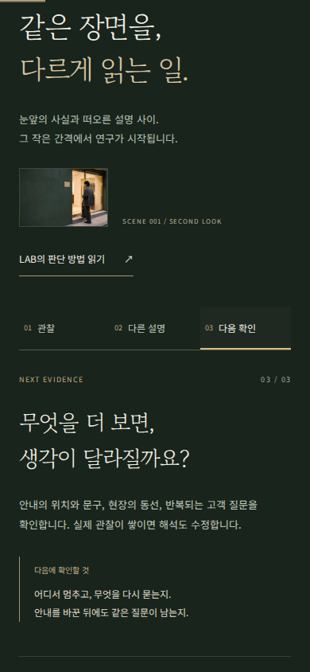

# R3.1 홈페이지 운영 배포 및 최종 검수

2026-10-28. **운영 배포 완료.** 사용자의 후속 요청 “모바일 버전 체크까지 하고 배포 해주세요”에 따라 기존 Preview 검수본을 홈페이지와 `/mobile/`에 반영했다.

- 운영: https://mashcore.co.kr/
- 모바일 주소: https://mashcore.co.kr/mobile/
- 출시 PR: https://github.com/HotCharliepepper/Mashcore/pull/13 — merged
- 운영 커밋: `a8dae1c4b6e69cd02e24b5e28bc9600f5a756fcf`
- Netlify 운영 배포: `6ae1f7c19ddb6a779b397b20`, `ready`, `production`, `main`
- 공개 시각: 2026-10-28 13:25:35 UTC / 22:25:35 KST
- 출시 전 Preview: https://deploy-preview-13--mashcore.netlify.app/
- 기존 Draft PR #12 및 실험 Preview는 보존했다.

## 반영 내용

검수된 Runway MP4, WebP, GSAP, Origin × Research 화면을 `/assets/r31/`의 명시적 공개 파일 5개로 배포한다. 모바일 주소도 동일한 반응형 HTML을 사용하며 문안과 서비스 CTA가 영상보다 먼저 나온다. 모바일 자동 영상 재생은 없고 탭으로 재생·정지한다. 데스크톱 영상은 한 번 재생하며 반복하지 않는다.

Research의 관찰 → 다른 설명 → 다음 확인 버튼, Chore to Play 여섯 관점, LAB·NOTES·Signal Studio·Weplace·서비스·기존 문의와 사업자 정보는 보존한다. 홈페이지의 Preview 표기를 제거했다. 운영 canonical·검색 허용·13개 sitemap URL을 확인했다. 실험 `/r31-review/`는 여전히 deploy-preview에서만 생성된다.

기존 `check_interactions.cjs`에서 정적 사업자 footer까지 동적 대체를 기대하던 테스트를 실제 계약에 맞게 수정했다. 정적 정보 보존과 빈 footer의 안전한 fallback을 각각 검사한다. 공개 `site.js`는 변경하지 않았다.

## 실제 검사 결과

| 검사 | 결과 |
|---|---|
| 출시 전 Preview 브라우저 검사 | **197 PASS / 0 FAIL** — `b7231662cf117f26030d39864de775334990320a` |
| 배포 후 실제 운영 도메인 브라우저 검사 | **197 PASS / 0 FAIL** — `a8dae1c4b6e69cd02e24b5e28bc9600f5a756fcf` |
| 화면 크기 | Chromium 320×700, 390×844, 768×1024, 1440×900 |
| 모바일 터치 | Chromium 및 WebKit 에뮬레이션: 재생·정지, 연구 선택, 메뉴 열기·Escape 닫기 |
| `/mobile/` | Chromium 및 WebKit 390×844: 정확한 커밋, 첫 화면 CTA, 영상보다 문안 우선, 포스터, 연구 탭, 문의 앵커, 가로 넘침 없음 |
| 영상 | 1920×1080 실제 디코딩, 약 6초, 재생시간 증가, pause/resume, 화면 이탈 pause, 종료 후 비반복, replay |
| GSAP | 고정 3.15.0 로드, 선·원의 실제 computed style 변화 |
| 키보드 | skip, Tab, Enter/Space, 포커스 표시, 메뉴 Escape |
| 대체 상태 | JS·MP4·GSAP·이미지 로드 실패, reduced-motion, saveData에서 핵심 문안·CTA·문의 보존 |
| 기존 링크 | 서비스·LAB·NOTES·Chore·Studio·Weplace HTTP 200 + H1 |
| 정적 구조 | source HTML 16개, 링크·구조 오류 0 |
| 배포 경계 | 10개 테스트 통과, production/branch-deploy/deploy-preview 세 context 검사 통과 |
| 기존 인터랙션 | 메뉴·문의·footer 14개 검사 그룹, 공간 모형 9개 검사 그룹 통과 |

실행 환경은 GitHub Actions Ubuntu 24.04 / Playwright 1.57.0 / Chromium + WebKit이다. Cloud Browser에서도 운영 홈페이지의 Research 전환과 문의 이동을 직접 조작했다. 문의 도착 위치는 viewport top 23.8px이며 이메일 작성 링크가 유지된다. 메일은 발송하지 않았다.

- [출시 전 QA 실행](https://github.com/HotCharliepepper/Mashcore/actions/runs/40695175997)
- [운영 QA 실행](https://github.com/HotCharliepepper/Mashcore/actions/runs/40696271246)
- [운영 전체 24개 캡처와 JSON](https://github.com/HotCharliepepper/Mashcore/actions/runs/40696271246/artifacts/12819816571) — Actions 보관 기한 2026-11-27

핵심 운영 캡처 4개와 검사 JSON은 이 Git 브랜치에 별도 보존한다. `results.json`의 “Preview permits crawling noindex” 행은 공통 robots 허용 검사의 기존 표시 이름이다. 운영 noindex 부재와 sitemap은 별도 항목에서 실제 검증했다.

## 미실시

실물 iPhone·Android, 실제 Safari·Firefox, 스크린리더 청취, 브라우저 기본 200% 확대, 고객 이해도 테스트, 실제 메일 송수신, 운영 Core Web Vitals는 미실시다. WebKit 모바일 에뮬레이션을 실물 Safari 검사로 표현하지 않는다. 문의는 사용자의 메일 앱에서 작성하는 기존 방식이다.

DNS·결제·DB·고객 데이터·유료 API·유료 영상 생성은 변경하거나 실행하지 않았다. 검색엔진 등록은 수행하지 않았다.

## 다음 시각 개선 후보

1. 제공 영상의 세로 crop을 비교해 작은 화면에서 인물과 출입문 비중을 조정한다.
2. Research의 단계별 신호선 강조를 비교하되 문안의 가독성을 유지한다.
3. 실제 모바일 읽기 반응을 바탕으로 Research에서 Chore 구간으로 이어지는 여백과 길이를 다듬는다.

## 복구 기준

필요할 때 사용 가능한 직전 운영 배포는 `6ae1a4963bb4e121a64b6c25`, 직전 main은 `2d38bb0cf68ea636cccb84e7ef9c0ce17043c017`이다. 이번 작업에서 롤백은 실행하지 않았다. 이 증빙 브랜치는 문서와 캡처만 추가하며 운영 소스를 다시 배포하지 않는다.

## 운영 화면 캡처

